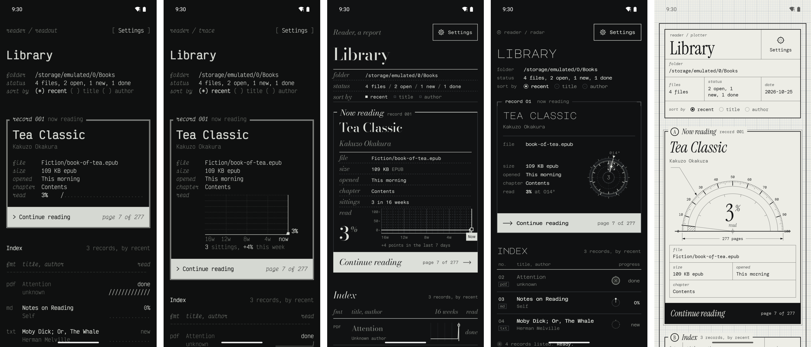

# Reader

An Android reader for EPUB, PDF, TXT and Markdown, with five looks.



## Features

- Lists every book in a folder and its subfolders.
- Five looks, each in light, dark and black.
- Contents, search, read aloud, and a scrubber marked with chapters.
- Reading positions are saved in the folder (`.reader/`, one file per device), so they follow it when you sync it between devices.

## Install

Needs Android 15 or later, USB debugging on the device, and Android Studio for its JDK.

```
./gw :app:assembleRelease
adb install -r app/build/outputs/apk/release/app-release.apk
```

`./gw` is gradlew with Android Studio's JDK. On first launch, choose the folder that holds your books.

## Develop

- `./gw :app:installDebug` installs a debug build.
- `LOOKS=readout ./gw :app:recordRoborazziDebug --tests app.reader.LookShots` renders one look to `app/screens/`. Leave out `LOOKS` for all of them.
